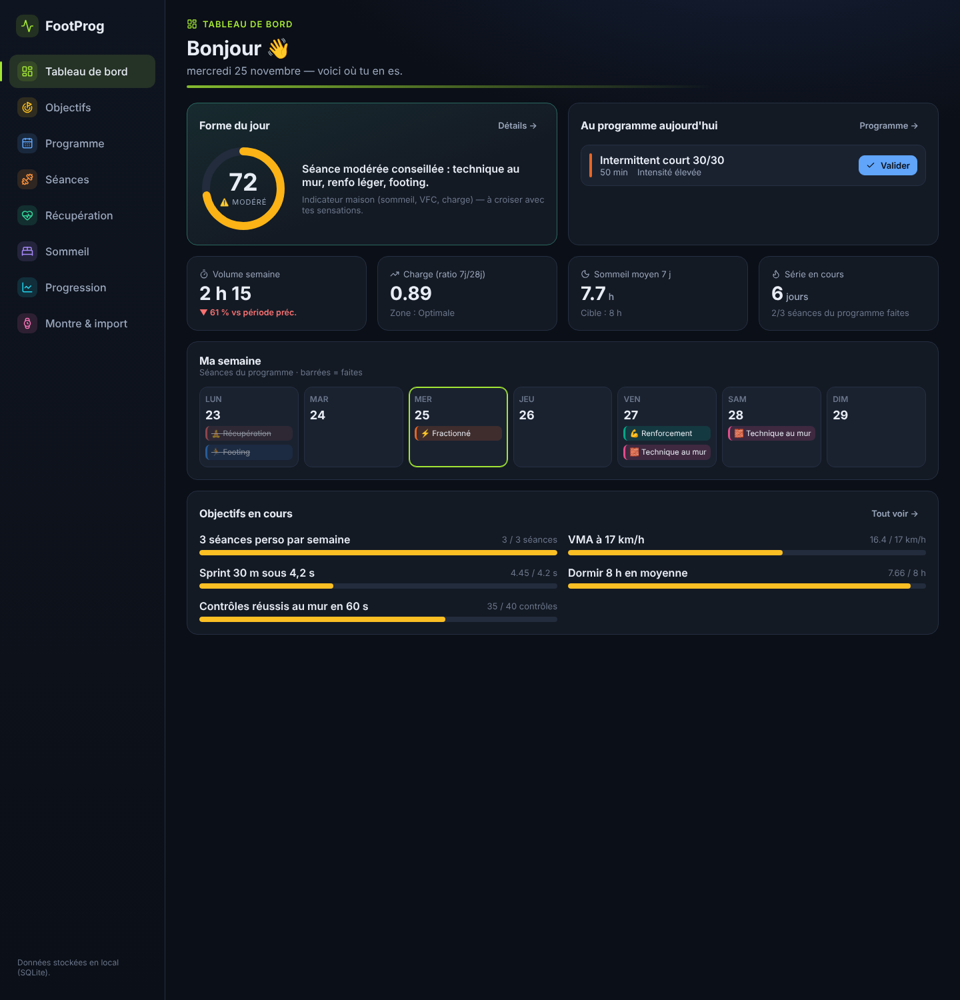

# FootProg — entraînement perso du footballeur amateur

📱 **App téléphone (hors ligne, installable)** : https://miha976.github.io/SportTrack/

Application locale pour **planifier**, **suivre** et **mesurer** ton entraînement individuel (footing, fractionné, renfo, appuis, technique au mur), ta **récupération** et ton **sommeil**, avec import des données de montre.

- **Frontend** : React 19 + TypeScript (Vite), architecture **MVVM**, Recharts, lucide-react
- **Backend** : Python **FastAPI** + SQLAlchemy 2 + **SQLite** (un fichier `backend/footprog.db`, rien à installer)
- **Version téléphone** : même front, sans serveur (IndexedDB ou base de l'artefact claude.ai), installable en PWA hors ligne — voir plus bas



## Lancer

Prérequis : Python ≥ 3.10, Node ≥ 20.

```bash
./start.sh          # macOS / Linux
start.bat           # Windows
```

Puis ouvre http://localhost:5173. Doc interactive de l'API : http://localhost:8000/docs

Lancement manuel :

```bash
cd backend && python -m venv .venv && source .venv/bin/activate
pip install -r requirements.txt
python -m app.seed --demo          # optionnel : 6 semaines de données fictives (EFFACE la base)
uvicorn app.main:app --reload --port 8000

cd frontend && npm install && npm run dev
```

Pour repartir de zéro : supprime `backend/footprog.db` (la bibliothèque d'exercices est recréée au démarrage).

## Version téléphone (sans serveur)

Le même front, mais la couche données tourne **dans le navigateur** : le générateur, les calculs de charge et de forme, et les imports GPX/TCX/FIT/CSV sont portés en TypeScript (`frontend/src/services/local/`). Seuls les repositories changent : les ViewModels et les vues sont identiques, c'est l'intérêt du MVVM.

```bash
cd frontend
npm run dev:mobile      # test sur le réseau local (ouvre l'URL « Network » sur ton téléphone)
npm run build:mobile    # → dist-mobile/ : un seul index.html + manifest + service worker
```

**Mise en ligne (GitHub Pages)** : Pages sert la racine de `main` (`index.html`, `sw.js`, manifest et icônes sont le build de la version téléphone, avec `.nojekyll`). Quand `frontend/` change, `.github/workflows/pages.yml` reconstruit et remet à jour ces fichiers automatiquement. Adresse : https://miha976.github.io/SportTrack/. Ouvre l'URL sur ton téléphone, puis :
- Android (Chrome) : menu ⋮ → *Ajouter à l'écran d'accueil* / *Installer l'application* ;
- iPhone (Safari) : bouton Partager → *Sur l'écran d'accueil*.

Une fois ouverte une première fois, l'app fonctionne **hors ligne** (service worker).

**Stockage** (choisi automatiquement, `services/local/store.ts`) :
| Contexte | Où vont les données |
|---|---|
| Artefact claude.ai | Base privée de l'artefact, liée à ton compte → mêmes données sur téléphone et ordinateur |
| PWA / navigateur | IndexedDB de l'appareil (hors ligne) |
| Rien de disponible | Mémoire (non conservé, signalé dans l'app) |

Onglet **Montre** → *Mes données* : exporter, copier ou restaurer une sauvegarde JSON, charger la démo, tout effacer. En mode appareil, exporte une sauvegarde régulièrement : vider les données du navigateur efface tout.

## Modules (une couleur par module)

| Module | Couleur | Ce qu'il fait |
|---|---|---|
| Tableau de bord | vert citron | Forme du jour, séance du jour (validation en 1 clic), semaine, objectifs |
| Objectifs | ambre | Objectifs **auto** (séances/sem., km, minutes par type, sommeil moyen) ou **manuels** (VMA, sprint 30 m, contrôles au mur en 60 s, gainage, jongles…) avec historique et courbe |
| Programme | bleu | **Générateur sur mesure** + semaine type éditable, progression +x %/sem., semaine allégée, suivi du réalisé |
| Séances | orange | Journal complet (perso, club, match), RPE, FC, distance, champs spécifiques (contrôles réussis/tentés, répétitions) |
| Récupération | vert | Score de forme, charge aiguë/chronique et ratio, routine de récup à cocher |
| Sommeil | violet | Saisie (coucher/réveil → durée auto), phases, VFC, FC repos, dette et régularité |
| Progression | cyan | Volume par type, charge, respect du programme, distance, allure footing, sommeil, courbes des tests |
| Montre & import | rose | Import **GPX / TCX / FIT** (activités) et **CSV** (sommeil), doublons ignorés |

## Logique métier

**Générateur de programme** (`backend/app/services/generator.py`) — à partir de tes jours dispo, jours de club, jour de match, priorités et niveau :
- J+1 match → récupération ; J-1 → activation technique légère ;
- séances intenses (fractionné, appuis) jamais consécutives, ni collées à un entraînement club, placées le plus loin possible du match ;
- volume hebdo plafonné selon le niveau ; ce qui ne rentre pas devient un **complément court** greffé à une séance légère, sinon une note t'explique pourquoi.

**Charge** = durée × RPE (méthode sRPE). Aiguë = 7 jours, chronique = moyenne hebdo sur 28 jours, ratio repère 0,8 – 1,3. Indicateur utile pour repérer les hausses brutales, discuté scientifiquement comme prédicteur de blessure.

**Forme du jour** (0-100) : base 70, ajustée par la durée/qualité du sommeil, la VFC et la FC de repos vs ta moyenne, le ratio de charge et l'intensité de la veille. Chaque facteur est affiché.

## Architecture MVVM (frontend)

```
src/
  models/        M  types du domaine, catalogue (couleurs, libellés), utilitaires de dates
  services/         client HTTP + repositories (seul accès à l'API)
  viewmodels/    VM hooks useXxxViewModel : état, données dérivées, commandes
  views/         V  pages + composants, aucun appel réseau, uniquement le VM
```

Chaque page consomme un seul ViewModel (`const vm = useGoalsViewModel()`), qui orchestre les repositories et expose l'état et les commandes. Les vues restent déclaratives et testables séparément.

## Montre

Aujourd'hui : import de fichiers (exemples dans `docs/exemples/`). Les parseurs de `services/importers.py` produisent un format neutre : brancher plus tard l'API d'un constructeur (ou Strava) revient à écrire un adaptateur qui renvoie ces mêmes dictionnaires puis réutilise la route d'import. Avant d'acheter, vérifie que la montre exporte en FIT/TCX ou propose une API ouverte, et qu'elle mesure VFC + sommeil.

## API (extrait)

`GET /api/stats/dashboard` · `GET /api/stats/weekly?weeks=12` · `GET /api/stats/load` · `CRUD /api/goals` (+ `/measurements`) · `CRUD /api/programs` (+ `/generate`, `/planning`, `/sessions`) · `CRUD /api/sessions` · `CRUD /api/sleep` · `POST /api/import/activity|sleep` · `GET /api/exercises`
